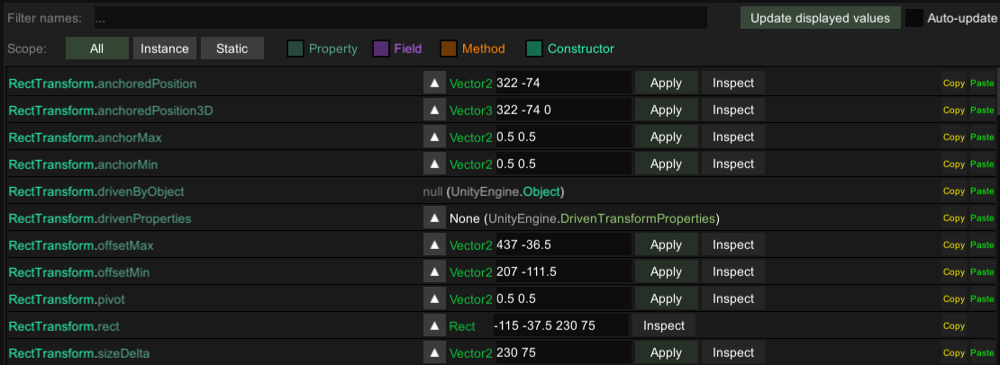

# Mod Menu
A mod menu for Cryptid Farm

## Target Values for Mod Menu Button in Main Menu



## How to write your own .csproj.user file
```xml
<Project>
  <PropertyGroup>
    <!-- Game path -->
    <GameDir>PATH_TO_GAME_FOLDER</GameDir>
  </PropertyGroup>

  <!-- Auto-copy DLL to game's mod folder -->
  <Target Name="Copy Mod Files" AfterTargets="Build">
    <Copy SourceFiles="$(TargetDir)$(TargetFileName)" DestinationFolder="$(GameDir)\Mods" />
  </Target>
</Project>
```
